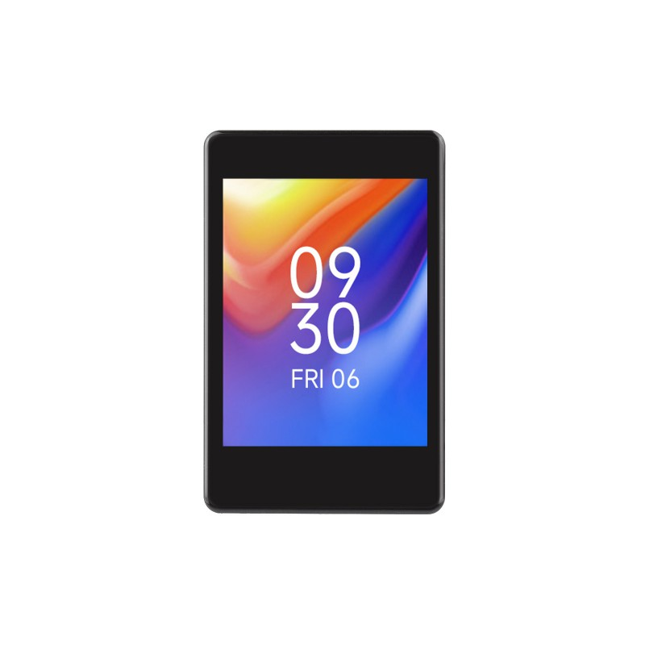

  <h1>ESP32-S3-Touch-LCD-2</h1>
  
<strong>ESP32-S3 development board with a 2-inch 240 × 320 capacitive touchscreen</strong>

  
<strong>English</strong> | <a href="README_ZH.md">简体中文</a>

  

    
    
  

  

    <a href="https://www.waveshare.com/esp32-s3-touch-lcd-2.htm">🛒 Product</a> &middot;
    <a href="firmware/">📦 Firmware</a> &middot;
    <a href="examples/esp-idf/">🧩 ESP-IDF</a> &middot;
    <a href="examples/arduino/examples/">🔧 Arduino</a> &middot;
    <a href="https://docs.waveshare.com/ESP32-S3-Touch-LCD-2/">📖 Documentation</a>
  

  

---

## ✨ Overview

The board includes a capacitive touchscreen, a six-axis IMU, a microSD slot, and a camera connector. This repository provides ESP-IDF and Arduino examples.

| Feature | Device / interface |
| --- | --- |
| MCU | ESP32-S3R8 |
| Memory | 16 MB Flash, 8 MB PSRAM |
| Display | 2 inches, 240 × 320, SPI, ST7789 |
| Touch | CST816D, I²C |
| Six-axis IMU | QMI8658 |
| Camera connector | OV2640 or OV5640 |

## 📦 Quick Start

To restore the factory demo, download the factory image from [`firmware/`](firmware/) and follow the flashing instructions there.

The fastest way to try an example is a ready-to-flash package from the
[latest release](https://github.com/waveshareteam/ESP32-S3-Touch-LCD-2/releases/latest).

1. Download the `*-combined.zip` package for the example and framework version you need.
2. Extract the archive and install esptool with `python -m pip install esptool`.
3. Connect the board over USB.
4. Run `flash_combined.bat COMx` on Windows or `./flash_combined.sh /dev/ttyACM0` on Linux.
5. Reset the board if it does not restart automatically.

If a release package is unavailable, follow the linked example instructions to build from source.

## 🧪 Examples

### ESP-IDF

| Example | Main feature |
| --- | --- |
| [`01_sd_card_test`](examples/esp-idf/01_sd_card_test/) | Read and write a Micro SD card |
| [`02_lvgl_qmi8658`](examples/esp-idf/02_lvgl_qmi8658/) | Show QMI8658 IMU readings |
| [`03_lvgl_brightness`](examples/esp-idf/03_lvgl_brightness/) | Adjust the LCD backlight |
| [`04_lvgl_battery`](examples/esp-idf/04_lvgl_battery/) | Show battery voltage |
| [`05_lvgl_camera`](examples/esp-idf/05_lvgl_camera/) | Preview camera images on the LCD |
| [`06_lvgl_example`](examples/esp-idf/06_lvgl_example/) | Run LVGL graphics demos |

### Arduino

| Example | Main feature |
| --- | --- |
| [`01_factory`](examples/arduino/examples/01_factory/) | Run the board diagnostics demo |
| [`02_gfx_helloworld`](examples/arduino/examples/02_gfx_helloworld/) | Display HelloWorld using Arduino GFX |
| [`03_sd_card_test`](examples/arduino/examples/03_sd_card_test/) | Read and write a Micro SD card |
| [`04_qmi8658_output`](examples/arduino/examples/04_qmi8658_output/) | Print QMI8658 readings to the serial monitor |
| [`05_lvgl_qmi8658`](examples/arduino/examples/05_lvgl_qmi8658/) | Show QMI8658 IMU readings |
| [`06_lvgl_battery`](examples/arduino/examples/06_lvgl_battery/) | Show battery voltage |
| [`07_lvgl_brightness`](examples/arduino/examples/07_lvgl_brightness/) | Adjust the LCD backlight |
| [`08_lvgl_example`](examples/arduino/examples/08_lvgl_example/) | Run LVGL graphics demos |
| [`09_lvgl_camera`](examples/arduino/examples/09_lvgl_camera/) | Preview camera images on the LCD |
| [`10_camera_web_server`](examples/arduino/examples/10_camera_web_server/) | Stream camera images to a browser |

Libraries used by the sketches are bundled in [`examples/arduino/libraries`](examples/arduino/libraries/).

## 🛠️ Development Environment

| Framework | Version | Examples |
| --- | --- | ---: |
| ESP-IDF | `v5.3.2` | 6 |
| Arduino-ESP32 | `3.1.1` | 10 |

## 📚 Resources

- [Schematic](hardware/schematic/)
- [Product page](https://www.waveshare.com/esp32-s3-touch-lcd-2.htm)
- [Wiki](https://docs.waveshare.com/ESP32-S3-Touch-LCD-2/)

## 🤝 Support

- Example or repository problem: [open an issue](https://github.com/waveshareteam/ESP32-S3-Touch-LCD-2/issues/new/choose).
- Product usage, hardware or order questions: [Waveshare support](https://service.waveshare.com/).

## 📄 License

Bundled third-party code and resources retain their respective license and copyright notices.
