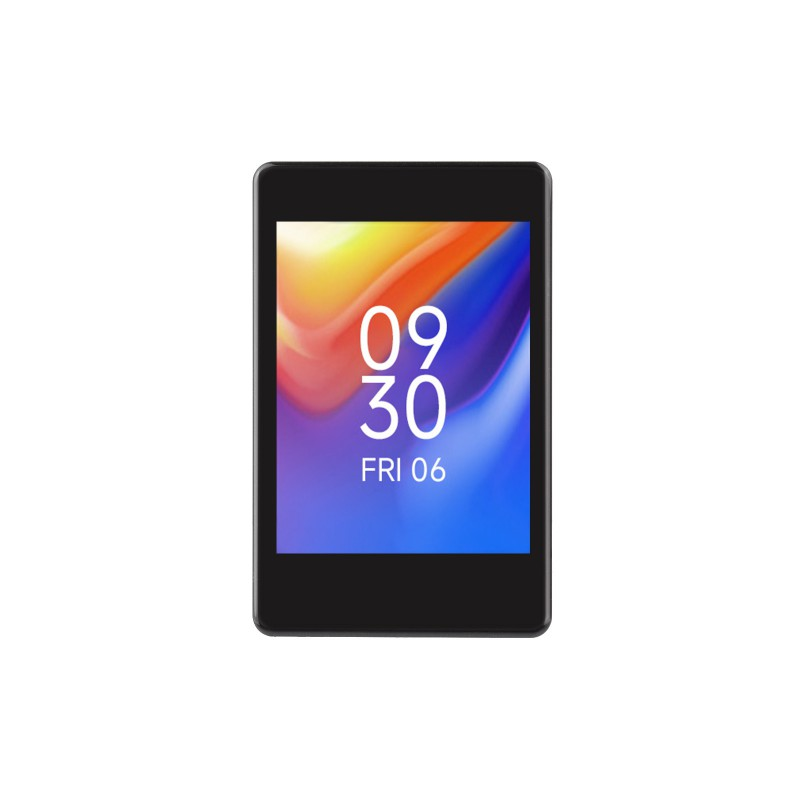

  <h1>ESP32-S3-Touch-LCD-2</h1>
  
<strong>ESP32-S3 2 英寸 240 × 320 电容触摸屏开发板</strong>

  
<a href="README.md">English</a> | <strong>简体中文</strong>

  

    
    
  

  

    <a href="https://www.waveshare.com/esp32-s3-touch-lcd-2.htm">🛒 产品</a> &middot;
    <a href="https://github.com/waveshareteam/ESP32-S3-Touch-LCD-2/releases/latest">📦 固件</a> &middot;
    <a href="examples/esp-idf/">🧩 ESP-IDF</a> &middot;
    <a href="examples/arduino/examples/">🔧 Arduino</a> &middot;
    <a href="https://docs.waveshare.net/ESP32-S3-Touch-LCD-2/">📖 文档</a>
  

  

---

## ✨ 概述

这款开发板带有电容触摸屏、六轴惯性传感器、Micro SD 卡槽和摄像头接口。本仓库提供 ESP-IDF 和 Arduino 示例。

| 功能 | 器件或接口 |
| --- | --- |
| MCU | ESP32-S3R8 |
| 存储器 | 16 MB Flash，8 MB PSRAM |
| 显示 | 2 英寸，240 × 320，SPI，ST7789 |
| 触摸 | CST816D, I²C |
| 六轴惯性传感器 | QMI8658 |
| 摄像头接口 | OV2640 或 OV5640 |

## 📦 快速开始

体验示例最快的方法是使用[最新版本](https://github.com/waveshareteam/ESP32-S3-Touch-LCD-2/releases/latest)中打包好的可烧录固件。

1. 下载所需示例和框架版本对应的 `*-combined.zip`。
2. 解压后通过 `python -m pip install esptool` 安装 esptool。
3. 通过 USB 连接开发板。
4. Windows 运行 `flash_combined.bat COMx`，Linux 运行 `./flash_combined.sh /dev/ttyACM0`。
5. 如果开发板未自动重启，请手动复位。

若当前没有发布包，请按下方示例说明从源码构建。

## 🧪 示例

### ESP-IDF

| 示例 | 主要功能 |
| --- | --- |
| [`01_sd_card_test`](examples/esp-idf/01_sd_card_test/README_ZH.md) | 读写 Micro SD 卡 |
| [`02_lvgl_qmi8658`](examples/esp-idf/02_lvgl_qmi8658/README_ZH.md) | 显示 QMI8658 惯性传感器数据 |
| [`03_lvgl_brightness`](examples/esp-idf/03_lvgl_brightness/README_ZH.md) | 调节屏幕背光 |
| [`04_lvgl_battery`](examples/esp-idf/04_lvgl_battery/README_ZH.md) | 显示电池电压 |
| [`05_lvgl_camera`](examples/esp-idf/05_lvgl_camera/README_ZH.md) | 在屏幕上预览摄像头画面 |
| [`06_lvgl_example`](examples/esp-idf/06_lvgl_example/README_ZH.md) | 运行 LVGL 图形演示 |

### Arduino

| 示例 | 主要功能 |
| --- | --- |
| [`01_factory`](examples/arduino/examples/01_factory/README_ZH.md) | 运行板载外设综合测试 |
| [`02_gfx_helloworld`](examples/arduino/examples/02_gfx_helloworld/README_ZH.md) | 用 Arduino GFX 显示 HelloWorld |
| [`03_sd_card_test`](examples/arduino/examples/03_sd_card_test/README_ZH.md) | 读写 Micro SD 卡 |
| [`04_qmi8658_output`](examples/arduino/examples/04_qmi8658_output/README_ZH.md) | 通过串口输出 QMI8658 数据 |
| [`05_lvgl_qmi8658`](examples/arduino/examples/05_lvgl_qmi8658/README_ZH.md) | 显示 QMI8658 惯性传感器数据 |
| [`06_lvgl_battery`](examples/arduino/examples/06_lvgl_battery/README_ZH.md) | 显示电池电压 |
| [`07_lvgl_brightness`](examples/arduino/examples/07_lvgl_brightness/README_ZH.md) | 调节屏幕背光 |
| [`08_lvgl_example`](examples/arduino/examples/08_lvgl_example/README_ZH.md) | 运行 LVGL 图形演示 |
| [`09_lvgl_camera`](examples/arduino/examples/09_lvgl_camera/README_ZH.md) | 在屏幕上预览摄像头画面 |
| [`10_camera_web_server`](examples/arduino/examples/10_camera_web_server/README_ZH.md) | 在浏览器中查看摄像头画面 |

草图使用的库随仓库提供，位于 [`examples/arduino/libraries`](examples/arduino/libraries/)。

## 🛠️ 开发环境

| 开发框架 | 版本 | 示例数 |
| --- | --- | ---: |
| ESP-IDF | `v5.3.2` | 6 |
| Arduino-ESP32 | `3.1.1` | 10 |

## 📚 资料

- [原理图](hardware/schematic/)
- [产品页](https://www.waveshare.com/esp32-s3-touch-lcd-2.htm)
- [Wiki](https://docs.waveshare.net/ESP32-S3-Touch-LCD-2/)

## 🤝 支持

- 产品使用、硬件或订单问题：[微雪技术支持](https://docs.waveshare.net/ESP32-S3-Touch-LCD-2/Technical-Support/)。

## 📄 许可证

随附的第三方代码及资源适用各自的许可证和版权声明。
